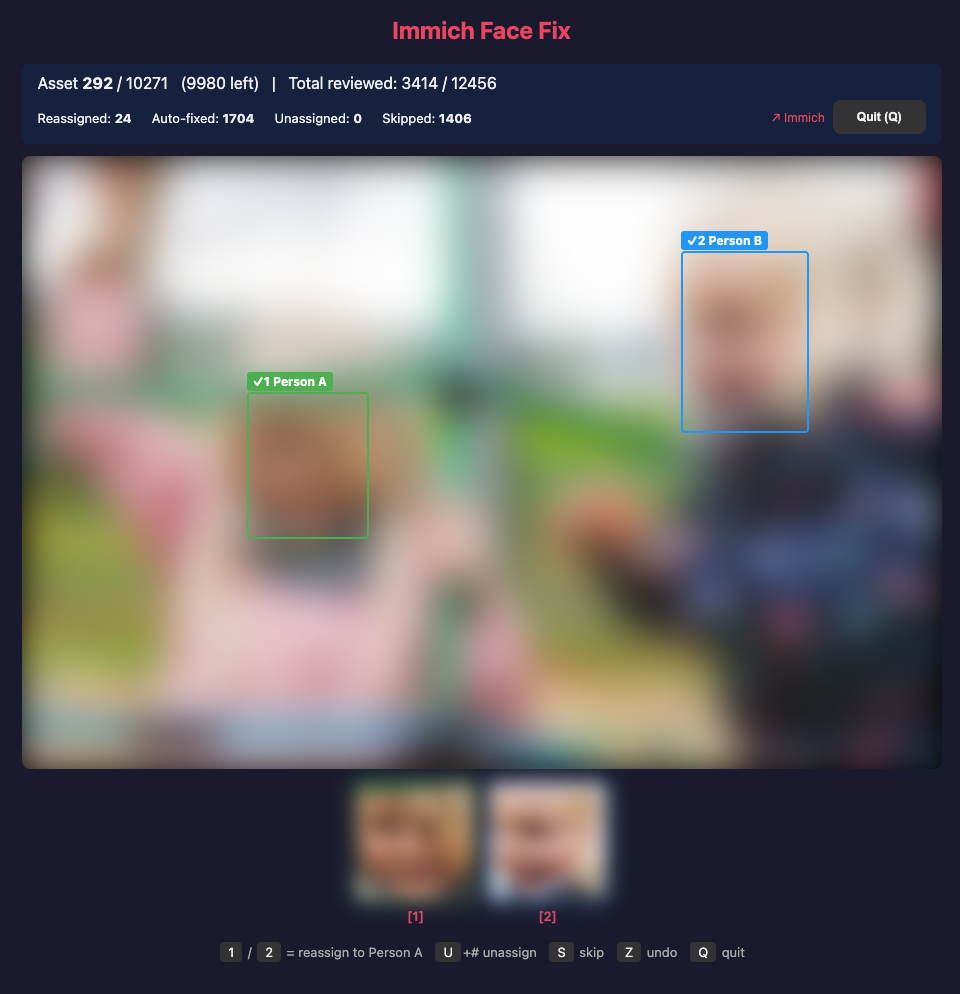

# Immich Face Fix

A web-based tool for bulk-correcting misassigned faces in [Immich](https://immich.app/), particularly useful for twins, siblings, or look-alikes where the ML model struggles to distinguish between individuals.

## The Problem

Immich's face recognition works well for most people, but it has a fundamental limitation with look-alikes. When two people (e.g., twins, young siblings) have similar facial features, their 512-dimensional embedding vectors end up very close in vector space. The ML model assigns faces by nearest-neighbor search — if the closest known face belongs to Person A, the new face gets assigned to Person A, even if it's actually Person B.

For a large, already-processed photo library, the standard advice is to lower the **Maximum recognition distance** (`maxDistance`) and re-run face recognition. Here's why that doesn't work well in practice:

### Why lowering `maxDistance` + rescanning falls short

| | Lowering maxDistance + rescan | Immich Face Fix |
|---|---|---|
| **Scope** | Reprocesses your *entire* library — every face, every photo | Only touches the specific person pair you select |
| **Time** | Hours to days for large libraries (10k+ photos) | Minutes of interactive review |
| **Collateral damage** | Stricter threshold causes *other* people to fragment into multiple persons — you fix twins but break everyone else | Zero impact on other people |
| **Manual work lost** | A full rescan discards all your previous manual merges, name assignments, and corrections | Preserves everything — only changes what you explicitly approve |
| **Precision** | Blunt instrument — same threshold applied globally to faces that vary wildly in quality and similarity | Per-face decisions with full photo context, face crops, and undo |
| **Reversibility** | Hard to undo — you'd need to re-merge split persons manually | Full undo stack, every reassignment can be reversed instantly |

The core issue is that `maxDistance` is a **global** parameter. Twins as toddlers may need a threshold of 0.3 to separate, but at that distance your library will fragment — distinct people whose faces happen to be slightly varied (different lighting, angles, ages) get split into multiple persons. There is no single threshold that correctly separates look-alikes while keeping everyone else intact.

### Why targeted corrections actually work

Immich does **not** use averaged embeddings per person. It stores every individual face embedding and searches against all of them. This means:

- When you reassign a face from Person A to Person B, that embedding immediately becomes a reference point for Person B
- Manual assignments are treated identically to ML-detected ones during future recognition
- Each correction makes future recognition more accurate — you're adding real training data to the search index
- You don't need to fix every photo; even a subset of corrections across age ranges significantly improves accuracy
- As subjects age and their features diverge, recognition naturally improves on its own



## Features

- **Merge unnamed people** (needs `--psql`) — scans every unnamed person against your named people and merges the clear matches in one click, using a bar measured on your own library
- **Two-way sort** (needs `--psql`) — sorts a look-alike pair in both directions at once, including individual faces from unnamed clusters, with a spot check instead of photo-by-photo review
- **Undo a whole run** — every automatic run is journaled and can be reversed from the start page
- **Person pair selection** — pick the "wrong" person (has misassigned faces) and the "correct" person (who those faces belong to)
- **Smart filtering** — review duplicates only (photos where both people appear), solos only, or both
- **Pair model** (optional) — trains a classifier on just the two selected people, shows its confidence on each face crop, and learns from your decisions as you go
- **Auto-fix mode** — when the pair model (or, without it, Immich's suggestion) is confident, auto-reassign with a configurable countdown you can cancel, or instantly once you've approved enough recommendations
- **One-person-per-photo rule** — one person can't appear twice in a photo, so two faces with the same label are compared head to head and never both moved or both kept automatically
- **Face overlays & crops** — bounding boxes on the full photo plus zoomed-in face crops so you can see exactly what you're reassigning
- **Unassign faces** — press `U` to remove a face from the wrong person entirely (creates a new unnamed person, same as Immich's "not this person"). In dup mode, press `U` then a number to pick which face
- **Keyboard-driven** — `Y`/`N` for solo faces, `1`-`9` to pick which face in multi-face photos, `U` to unassign, `S` skip, `Z` undo, `Q` quit
- **Session persistence** — progress saved to localStorage, resume where you left off across browser sessions
- **Full undo stack** — every reassignment can be reversed
- **Skip-both-present** — automatically skip photos where both people already appear correctly

## Setup

### Requirements

- A running [Immich](https://immich.app/) instance
- An Immich API key with the required permissions (see below)
- Python 3 (no external dependencies)
- Optional, for the pair model: a way to run `psql` against the Immich database

### API Key Permissions

When creating the API key in Immich (Account Settings → API Keys), grant the following permissions:

| Permission | Why |
|---|---|
| `Asset.Read` | Search assets by person |
| `Asset.View` | Load photo thumbnails/previews |
| `Face.Read` | Get face bounding boxes per asset |
| `Face.Update` | Reassign a face to a different person |
| `Person.Create` | Create unnamed person for unassign action |
| `Person.Delete` | Clean up orphaned unnamed person on undo |
| `Person.Read` | List people, get thumbnails, get top suggestion |
| `Person.Reassign` | Reassign faces between people |
| `Server.About` | Connectivity check on startup |

These are the minimum permissions required. Do **not** use an "All" key if you want to limit the blast radius.

### Running

1. Clone this repository:
   ```bash
   git clone https://github.com/pabera/immich-face-fix.git
   cd immich-face-fix
   ```

2. Start the server:
   ```bash
   python3 serve.py --immich-url https://photos.example.com --api-key your-api-key-here
   ```

The tool opens automatically in your browser at `http://localhost:8080`.

### Options

| Flag | Description | Default |
|------|-------------|---------|
| `--immich-url` | Immich instance URL | `IMMICH_URL` env var |
| `--api-key` | Immich API key | `IMMICH_API_KEY` env var |
| `--port` | Local port | 8080 |
| `--host` | Address to bind. The proxy has no login, so only widen this on a network you trust | `127.0.0.1` |
| `--psql` | Command that opens `psql` on the Immich database; enables the pair model | `IMMICH_PSQL` env var |

### Enabling the pair model

Immich's API doesn't expose face embeddings, so the pair model reads them from the database. Pass any command that opens `psql` there. Nothing else needs to be installed, and no database port has to be opened:

```bash
# Immich runs on this machine
python3 serve.py --immich-url https://photos.example.com --api-key your-api-key-here \
  --psql "docker exec -i immich_postgres psql -U postgres -d immich"

# Immich runs on another machine
python3 serve.py --immich-url https://photos.example.com --api-key your-api-key-here \
  --psql "ssh my-server docker exec -i immich_postgres psql -U postgres -d immich"
```

Commands run over SSH get a shorter `PATH` than a login shell. If you see `docker: command not found`, use the full path to `docker` on the server. NAS systems often install it somewhere unusual.

Access is read-only: the queries run in a `READ ONLY` transaction, and every change still goes through the Immich API. The pair model loads only the two selected people's embeddings. Automatic clean-up loads faces of all your people, but not hidden people or other users' people. Either way they stay in your browser's memory for the session. Over SSH, `ssh -C` makes the large clean-up transfer faster. Embeddings are biometric data, which is one reason the server binds to localhost by default.

## Usage

1. **Select the wrong person** — the person in Immich who has faces that don't belong to them
2. **Select the correct person** — who those faces actually belong to
3. **Configure settings** — filter mode, auto-fix behavior, skip-both-present
4. **Start Review** — the tool fetches all assets assigned to the wrong person and walks you through them one by one
5. **Review each photo:**
   - **Solo face** (one wrong face on the photo): `Y` to reassign, `N` to keep, `U` to unassign
   - **Duplicate faces** (multiple wrong faces): press `1`, `2`, etc. to reassign a specific face; `U` then a number to unassign
   - `S` to skip, `Z` to undo last action, `Q` to quit
6. **Summary** — shows totals for reviewed, reassigned, auto-fixed, unassigned, skipped, and undone

## Automatic Clean-Up

Both tools need `--psql`, and neither changes anything until you press Apply.

1. **Select your look-alikes** as the wrong and correct person. Which is which doesn't matter for sorting. This also stops their clusters from being merged whole.
2. **Merge unnamed people.** Check the ready list, weakest matches first, and apply it. "Needs your eye" rows stay untouched unless you pick a person.
3. **Sort the two people.** Click any wrong face in the spot check. Optionally label the hard faces, then retrain. Apply when the spot check looks right.
4. **Repeat** sort, or use Start Review for what's left. Each round has better labels to learn from.

Applying is blocked if you reject more than 5% of the spot check, until you retrain.

### How unnamed people are matched

Each unnamed person is compared with all faces of every named person, up to 1,500 per person sampled evenly over time so a child's whole childhood is covered. The similarity bar isn't a fixed number. It's measured on your own library: the tool hides a day of a named person to see whether that day finds them again, then hides the person entirely, so any match is a false one. The bar goes just above the mistakes, allowing at most 1%, and the screen shows the result. Libraries with many close relatives get a higher bar and fewer automatic merges.

A cluster passing the bar still goes to "Needs your eye" if it has fewer than 3 faces, shares a photo with the candidate, appears twice in one photo, is close to a second person, or looks like a blend of two people. If the tool can't calibrate because too few people are named, nothing merges automatically.

A cluster close to either selected look-alike is never merged whole, because it may hold both. The Sort step adds its faces as unlabelled and places them one by one.

### How merges work

A merge moves each face with the same call as a manual fix, not Immich's merge endpoint, which deletes the source person and can't be undone. No extra API permissions are needed. Emptied unnamed people remain until Immich's nightly clean-up, and undo recreates them if they're gone.

The journal lives in this browser's localStorage and keeps the last 20 runs. Undo restores each face to where it was before the run, so it also reverses manual changes made to those faces since.

## How It Works

### Architecture

A single-page application (`index.html`) served by a lightweight Python proxy (`serve.py`). The proxy forwards `/api/*` requests to your Immich instance with the API key injected server-side — no credentials are exposed to the browser.

All face reassignments use the official [Immich API](https://immich.app/docs/api/). Database access is optional, read-only, and only used to read face embeddings.

### Pair Model

Nearest-neighbor search asks which known face is closest, and for look-alikes that answer is dominated by pose and lighting. The pair model (`classifier.js`) instead fits a logistic regression on the two selected people, which learns the specific direction that separates them.

The training labels are the Immich assignments being corrected, so the model is built not to trust them blindly:

- **Out-of-fold scores** — every face is scored by a model that never saw it, or any other face from the same day, so a wrong label can't confirm itself
- **Disputed labels set aside** — faces a first pass strongly disagrees with are dropped before the final fit
- **Balanced classes** — a person who "captured" the other's faces can't outvote them
- **Impossible labels excluded** — two faces in one photo with the same label can't both be right, so neither is used until you decide
- **Your decisions count most** — `Y`, `N`, numbered picks, and unassign become high-weight labels, saved per pair, and the model retrains every 25 decisions

The "separation" in the review header is measured against the noisy labels, so it understates the model when labels are bad. It's a rough guide, not an accuracy figure. The model is a single fit across the whole timeline, so it has no explicit notion of age, and photos from years the model has few faces for will tend to score less confidently.

If there are too few faces (under 30 per person), too few distinct days (under 5), or the database can't be reached, the tool says so and falls back to Immich's suggestion.

### Auto-Fix

Each photo gets one of three outcomes: move a face, leave it (auto-skip), or ask you. Faces need to reach the **Confidence** setting (default 97%) to be acted on. A photo with two wrong-labelled faces instead needs one clear head-to-head winner, and photos with three or more always go to you.

- **Confirm mode** — show the photo with a countdown timer; press any key to cancel and review manually
- **Instant mode** — act without showing the photo. It runs as Confirm until 20 recommendations have been seen with at least 95% approved, and locks again if that rate drops. Letting a countdown finish counts as approval; overruling one or undoing an auto-fix counts against it
- **Off** — always require manual review

Without the pair model, the signal is Immich's `closestAssetId` ranking. That ranking only measures distance to each person's **single feature photo**, not all of their faces, and it sorts favorites above everyone else regardless of distance. So the tool compares only people in the same favorite tier, and sends a face to manual review if exactly one of the pair is a favorite. Setting a clear, front-facing feature photo for both people improves this mode.

### Session Persistence

Progress, your decisions, and Instant-mode approvals are keyed by the wrong/correct person pair and stored in localStorage. You can close the browser, come back later, and pick up where you left off. Reset a session from the setup screen if needed.

## Immich Face Recognition Internals

For those interested in how Immich's recognition works under the hood:

### Face Detection & Embedding

1. Photos are processed by the ML service (default model: `buffalo_l` / ArcFace)
2. Each detected face produces a **512-dimensional embedding vector**
3. Embeddings are stored in PostgreSQL using the `vector` type with an HNSW index for fast similarity search

### Recognition

1. A new face's embedding is compared against **all stored face embeddings** via cosine distance
2. If the closest match is within `maxDistance` (default **0.5**) and belongs to a named person, the face is assigned to that person
3. Otherwise, if enough similar unassigned faces exist (`minFaces`, default **3**), a new person is created

### The Look-Alike Trap

Twins/siblings as babies often have embeddings within 0.3–0.4 cosine distance — well inside the 0.5 default threshold. Whichever person gets more photos processed first "captures" the other's faces, since their existing embeddings become the closest matches. Lowering the threshold globally breaks other people; targeted correction is the only precise fix.

### Key Parameters

| Parameter | Default | Description |
|-----------|---------|-------------|
| `maxDistance` | 0.5 | Cosine distance threshold. Lower = stricter. Range: 0 (identical) to 2 (opposite). |
| `minFaces` | 3 | Minimum similar unassigned faces before creating a new person. |
| `minScore` | 0.7 | Face detection confidence threshold. |

## Development

```bash
node --test test/
```

The tests use synthetic embeddings (`test/synthetic.js`), so they check the model's behavior, not its accuracy on real faces.

## License

MIT
